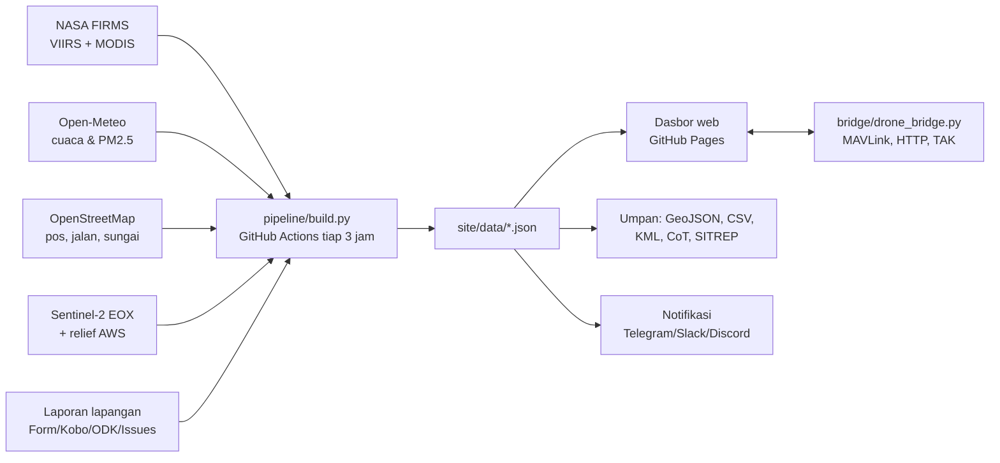

# Fire Tracker

Peta titik api (hotspot) dan dasbor terbuka kebakaran hutan dan lahan (karhutla) Indonesia untuk regu pemadam, BPBD, Manggala Agni, relawan, jurnalis, dan siapa pun yang terlibat.

**Buka situsnya: https://fire-tracker.fiveprayerapp.chatgpt.site/** · [Mirror GitHub Pages](https://ghanyr.github.io/pantau-api-nusantara/) (gratis, tanpa login, bisa dipasang di layar utama ponsel)

**Fire Tracker** memakai peta medan 3D MapLibre, citra Esri dan elevasi AWS/Mapzen. Titik dan animasi kamera tetap terlihat, sedangkan keterangan dan daftar dipindahkan ke panel.

- Cari kabupaten, provinsi, atau koordinat. Pencarian nama mencakup seluruh Indonesia.
- Daftar **Terbaru** diurutkan menurut waktu akuisisi satelit; pilih per wilayah atau per titik.
- Jendela 24 jam, 48 jam, dan 7 hari dihitung dari waktu sekarang, bukan umur berkas.
- Klik titik untuk waktu UTC/WIB, sensor, kepercayaan, FRP bila tersedia, koordinat desimal/DMS, salin brief, tautan langsung dan ekspor CSV/GeoJSON.
- Data asli NASA FIRMS dari empat sensor diperbarui terjadwal tiap 3 jam. Aplikasi memeriksa snapshot setiap 15 menit. Gangguan sumber mempertahankan salinan terakhir beserta tanggalnya.
- Kode frontend di [`tracker/`](tracker/), pipeline di [`pipeline/`](pipeline/), lisensi MIT. Tidak perlu akun untuk membaca situs dan umpan GIS.

**Deteksi panas bukan konfirmasi kebakaran, jumlah kejadian, luas terbakar atau status pemadaman.** Citra dasar bukan foto kejadian saat ini. Penetapan kabupaten menggunakan geoBoundaries ADM2 dengan toleransi pesisir sekitar 3 km; batas provinsi tampilan berasal dari BMKG. Waktu laporan lapangan selalu ditampilkan; data laporan versi GitHub Pages adalah snapshot bertanggal, bukan status langsung.

Alat lapangan versi sebelumnya tetap dapat dibuka di [**/legacy/**](https://ghanyr.github.io/pantau-api-nusantara/legacy/): paket offline per area, integrasi GIS/TAK, laporan dan alat drone. Pengelompokan, skor, ilustrasi asap dan perkiraan rambatan versi tersebut adalah hasil pengolahan dan perkiraan aplikasi, bukan bukti lapangan. Panduan di bawah bagian ini merujuk ke alat lanjutan tersebut.

Penyimpanan offline di GitHub Pages mencakup aplikasi, data terakhir dan ubin peta yang telah dilihat; area yang belum diunduh tetap memerlukan koneksi. Tautan repositori dan umpan lama dipertahankan agar integrasi tetap berfungsi.

## Drone & UAV

Buka panel **Drone** untuk [contoh dua UAV bergerak di peta 3D](https://fire-tracker.fiveprayerapp.chatgpt.site/#demo=1). Contoh selalu berlabel DEMO dan tidak menambah jumlah hotspot satelit. Pilih UAV untuk melihat arah hadap, baterai, ketinggian relatif titik lepas landas, jejak dan waktu posisi; tombol **Ikuti** mengaktifkan kamera, geser peta untuk melepasnya.

Hubungkan PX4/ArduPilot dengan bridge MAVLink, atau kirim telemetri dari gateway lain lewat SDK JSON. DJI yang kompatibel membutuhkan aplikasi/gateway SDK vendor; ini bukan koneksi otomatis ke semua model DJI. Situs publik menerima WSS; bridge lokal dapat menyajikan dashboard dan WS pada alamat yang sama. Token dan koneksi drone tidak disimpan atau disertakan dalam tautan berbagi.

- [Panduan koneksi dari clone baru](docs/UAV.md)
- [SDK JavaScript tanpa dependensi](sdk/README.md) · [contoh pengiriman](sdk/examples/publish-json.mjs) · [adapter DJI OSD](sdk/examples/dji-osd.mjs)
- [Kontrak telemetri terbuka](schemas/telemetry.schema.json)

Penghubung ini membaca telemetri; pengendalian tetap melalui aplikasi pilot. Integrasi telah diuji dengan simulator dan server lokal; setiap perangkat nyata tetap memerlukan uji sambung di lapangan.

## Menjalankan antarmuka Fire Tracker

Memerlukan Node 22.13+ dan Python 3.12+ untuk pipeline.

```sh
cd tracker
npm ci
curl --fail -L https://ghanyr.github.io/pantau-api-nusantara/data/observations.json -o public/data/observations.json
npm run dev
```

`npm test` menguji jendela waktu, pengelompokan, parsing, ekspor dan tautan titik. `npm run build` menghasilkan `tracker/dist/`. Untuk publikasi statis lengkap, jalankan pipeline seperti alur GitHub Actions, lalu `python web/build_site.py --out site` dan `node tracker/scripts/install-pages.mjs site`. Publikasikan direktori `site/`; URL data mengikuti lokasi instalasi sehingga fork dapat memperbarui datanya sendiri. Versi Sites memakai komponen yang sama dan API cuaca/laporan; identitas hosting, kredensial dan kode akun Sites tidak disertakan di repo publik.

Snapshot nasional mentah untuk aplikasi lain: [`data/observations.json`](https://ghanyr.github.io/pantau-api-nusantara/data/observations.json). `rows` tidak digabung per piksel; urutan kolom ada pada `columns`, waktu Unix milidetik UTC, FRP hilang bernilai `null`, `sources`/`provinces`/`municipalities` memberi arti indeks. Umpan 24 jam lama di `data/feeds/` berisi piksel yang dikelompokkan dan tidak setara dengan jumlah observasi mentah.

## Cara pakai

| Saya ingin… | Caranya |
|---|---|
| Belajar memakai dasbor | Tombol **Panduan** di kanan atas (7 langkah, muncul otomatis pada kunjungan pertama). |
| Melihat kondisi terkini | Buka situsnya (GitHub Pages repo ini). Pilih insiden di daftar kiri. |
| Melihat api menyebar | Tombol besar **Putar 7 hari terakhir** di bawah peta. |
| Melihat 3D dan animasi api | Pilih insiden lalu tekan **3D**. Sudut **Dekat** membawa kamera rendah ke api; nyala dan percikan bara tampil saat dekat. |
| Tahu ada api di dekat rumah | Tab **Dekat saya** › Pakai lokasi saya › pilih radius › **Dapat peringatan lewat Telegram**. |
| Mengirim ringkasan ke grup | Tombol **Salin SITREP** atau **WhatsApp** di panel insiden. |
| Menerbangkan drone ke titik panas | Tab **Drone** › Buat misi › Unduh paket misi (.zip) › buka di aplikasi kendali. |
| Memasukkan data ke QGIS/ArcGIS/Google Earth/ATAK | Tab **Integrasi** berisi tautan tetap dan langkahnya. |
| Melaporkan kondisi lapangan | Tab **Laporan** › isi formulir › Kirim lewat GitHub, atau salin ke WhatsApp. |
| Menjalankan versi sendiri | Lihat [Jalankan sendiri](#jalankan-sendiri). |

Tautan langsung: tambahkan `#ID-INSIDEN` di akhir alamat (misalnya `#KRH-SB9Z`), atau `#KRH-SB9Z-3d` untuk langsung ke 3D. Tab bisa dibuka dengan `#dekat`, `#drone`, `#laporan`, `#lainnya`.

## Cara kerja



1. **GitHub Actions** (`.github/workflows/update.yml`) menjalankan `pipeline/build.py` tiap 3 jam. Tidak perlu kunci API.
2. Pipeline mengunduh titik api, mengelompokkan menjadi insiden, menghitung skor, mengambil cuaca (termasuk riwayat 7 hari per 3 jam untuk animasi asap) dan kualitas udara, nama desa, pos pemadam, membuat paket 3D untuk 20 insiden prioritas teratas, citra detail untuk 60 insiden berikutnya, dan mosaik citra dasar Indonesia (zoom 8–9, disimpan di cache Actions).
3. **Bot Telegram** (`.github/workflows/bot.yml`, tiap 10 menit) menjawab pesan warga dan mengirim peringatan lokasi. Lokasi pelanggan disimpan terenkripsi di cabang `bot-state`.
4. Hasilnya ditulis ke `site/data/`, dipublikasikan di GitHub Pages, dan disimpan juga di cabang `data` supaya alat lain punya URL tetap:
   `https://raw.githubusercontent.com/<pemilik>/pantau-api-nusantara/data/data/incidents.json`
5. Dasbor (`web/index.html`) adalah satu file HTML tanpa proses build. Peta memakai deck.gl.

Rincian metode dan format data: [docs/DATA.md](docs/DATA.md). Drone: [docs/DRONE.md](docs/DRONE.md). Integrasi alat lain: [docs/INTEGRASI.md](docs/INTEGRASI.md).

## Jalankan sendiri

**Di GitHub (disarankan):**

1. Fork repo ini.
2. Settings › Pages › Build and deployment › Source: **GitHub Actions**.
3. Actions › "Perbarui data & situs" › **Run workflow**. Selesai sekitar 20–40 menit (cuaca untuk ratusan titik diambil pelan-pelan agar tidak membebani server gratis).
4. Opsional: isi secrets untuk notifikasi dan laporan lapangan (lihat di bawah).

**Di komputer atau server posko:**

```bash
pip install -r pipeline/requirements.txt
python -m pipeline.build --out site/data      # ambil & olah data
python web/build_site.py --out site           # susun situs
python -m http.server -d site 8000            # buka http://localhost:8000
```

Pilihan cepat: `--no-tiles` (tanpa paket 3D), `--no-weather`, `--no-geocode`. Semua pengaturan bisa diubah lewat variabel lingkungan; lihat `pipeline/config.py`.

Uji tanpa internet: `python pipeline/tests/make_fixtures.py && PAN_OFFLINE=1 python -m pipeline.build --out /tmp/uji --no-tiles`.

Uji beban seperti puncak musim kebakaran (±100 ribu deteksi): `python pipeline/tests/make_fixtures.py --besar /tmp/fixbesar && PAN_FIXTURES=/tmp/fixbesar PAN_OFFLINE=1 python -m pipeline.build --out /tmp/ujibesar --no-tiles`.

### Secrets & variabel (opsional)

| Nama | Isi |
|---|---|
| `TELEGRAM_BOT_TOKEN` | Token bot dari @BotFather. Dipakai bot peringatan warga dan peringatan grup |
| `SUBS_KEY` | Kunci enkripsi lokasi pelanggan bot. Buat dengan `python -c "from cryptography.fernet import Fernet;print(Fernet.generate_key().decode())"` |
| `TELEGRAM_BOT_USERNAME` (variable) | Nama bot tanpa @. Memunculkan tombol Telegram di tab Dekat saya |
| `TELEGRAM_CHAT_ID` | Peringatan insiden baru (skor ≥ 65) ke grup posko |
| `SLACK_WEBHOOK_URL`, `DISCORD_WEBHOOK_URL` | Peringatan ke Slack / Discord |
| `GENERIC_WEBHOOK_URL` | POST JSON `{type, text, incidents[]}` ke sistem Anda |
| `REPORTS_CSV_URL` | CSV publik laporan lapangan (Google Sheets, KoboToolbox, ODK); boleh beberapa, pisahkan koma |
| `NOTIFY_PROVINCES` (variable) | Batasi peringatan, misalnya `Kalimantan Tengah,Riau` |

### Bot peringatan warga (Telegram)

1. Di Telegram, buka @BotFather, kirim `/newbot`, salin token.
2. Repo › Settings › Secrets and variables › Actions: tambah secret `TELEGRAM_BOT_TOKEN` dan `SUBS_KEY`, lalu variable `TELEGRAM_BOT_USERNAME`.
3. Actions › "Bot Telegram (peringatan lokasi)" › Run workflow.

Warga cukup membuka tautan dari tab **Dekat saya** atau mengirim lokasi ke bot. Perintah: kirim lokasi, `/radius 10`, `/status`, `/ikuti KRH-XXXX`, `/berhenti` (menghapus lokasi). Bot berjalan tiap 10 menit di GitHub Actions, jadi balasan bisa tertunda beberapa menit. Lokasi dibulatkan ±100 m dan disimpan terenkripsi.

## Jembatan drone

```bash
pip install -r bridge/requirements.txt
python bridge/drone_bridge.py --mavlink udpin:0.0.0.0:14550 --site site
# buka http://localhost:8787, tab Drone, Hubungkan
```

Membaca MAVLink (ArduPilot, PX4, atau forwarding dari QGroundControl/Mission Planner), menerima POST JSON dari aplikasi lain (DJI MSDK, Node-RED, skrip), dan meneruskan ke dasbor serta jaringan TAK (`--cot-udp 239.2.3.1:6969`). **Hanya membaca**; tidak mengirim perintah terbang. Coba tanpa drone: `--sim 2`. Rincian: [docs/DRONE.md](docs/DRONE.md).

## Sumber data & lisensi

| Data | Sumber | Lisensi |
|---|---|---|
| Titik api | NASA FIRMS (LANCE NRT), VIIRS S-NPP/NOAA-20/NOAA-21, MODIS | Bebas pakai, sebutkan NASA FIRMS |
| Cuaca, kualitas udara | Open-Meteo (model ICON/GFS/ECMWF, CAMS) | CC BY 4.0 |
| Pos pemadam, jalan, sungai, desa | © kontributor OpenStreetMap, Overpass, Nominatim | ODbL |
| Citra satelit | Esri World Imagery (Maxar, Earthstar Geographics, Airbus, USGS, komunitas pengguna GIS) | Ketentuan Esri: gratis untuk pemakaian nonkomersial dengan atribusi, akun ArcGIS Developer, di bawah 1 juta ubin/bulan |
| Citra cadangan | Sentinel-2 cloudless oleh EOX IT Services (data Copernicus Sentinel termodifikasi) | CC BY-NC-SA 4.0 (nonkomersial) |
| Relief | AWS Terrain Tiles (Mapzen/Tilezen: SRTM, GMTED, ETOPO1) | Lihat atribusi Tilezen |
| Citra harian (asap) | NASA Worldview / GIBS | Bebas pakai |
| Peta dunia | NASA Blue Marble, Natural Earth | Domain publik |
| Batas wilayah | geoBoundaries | CC BY 4.0 |
| Kode | Repo ini | MIT |

Citra Esri dan Sentinel-2 cloudless dipakai untuk layanan publik nonkomersial dengan atribusi di pojok peta. Untuk pemakaian komersial, ganti `SAT_TILE_URLS` di `pipeline/config.py` dan `SAT` di `web/index.html` dengan sumber citra yang sesuai.

### Citra 3D ala Google Earth (opsional)

Tanpa kunci apa pun, 3D memakai citra Esri di atas relief AWS. Untuk tampilan persis Google Earth (Google Photorealistic 3D Tiles):

1. **Gratis, nonkomersial**: buat akun Cesium ion (paket Community), tambahkan aset "Google Photorealistic 3D Tiles" ke My Assets, buat token dengan Allowed URL alamat situs Anda, lalu isi variabel repo `CESIUM_TOKEN` (Settings → Secrets and variables → Actions → Variables). Kuota gratis sekitar 1.000 sesi 3D per bulan.
2. **Kunci Google langsung**: aktifkan Map Tiles API di Google Cloud (perlu akun penagihan; 1.000 permintaan gratis per bulan, lalu berbayar), batasi kunci ke domain situs, isi variabel repo `GOOGLE_TILES_KEY`.

Bila kuota habis atau kunci salah, 3D otomatis kembali ke citra Esri.

## Keterbatasan

- Satelit tidak melihat api di bawah awan atau asap tebal, dan bara gambut di bawah permukaan.
- Satelit lewat beberapa kali sehari; "aktif" berarti terdeteksi pada lintasan terakhir.
- "Jejak" = jumlah piksel VIIRS × 14 ha, bukan luas terbakar resmi.
- Peta gambut adalah perkiraan, bukan peta resmi KLHK.
- Api, jejak gelap, dan asap di 3D adalah ilustrasi deteksi satelit dan arah angin. Bukan rekaman api, peta luas terbakar, atau model sebaran asap.
- Saran taktis dibuat otomatis. Keputusan tetap di komandan lapangan.

## Berkontribusi

Laporan masalah, ide, dan perbaikan sangat diterima. Lihat [CONTRIBUTING.md](CONTRIBUTING.md). Cara termudah membantu tanpa menulis kode: tambahkan pos damkar, kantor BPBD, Daops Manggala Agni, jalan kebun, dan kanal di [openstreetmap.org](https://www.openstreetmap.org); semuanya ikut tampil di pembaruan berikutnya.

---

## English summary

Siaga Api is an open-source, auto-updating wildfire map for Indonesia. A GitHub Actions pipeline pulls NASA FIRMS hotspots every 3 hours, clusters them into prioritised incidents, adds weather (Open-Meteo), air quality and OpenStreetMap context, and prepares offline 3D packages for the top incidents. The single-file web app (deck.gl, dark by default) shows sharp Esri World Imagery from world zoom down to village level, a 7-day replay, and a 3D view where terrain runs to the horizon with illustrative fire glow and detection footprints, day-night by local time and wind-driven smoke. With a free Cesium ion token (or a Google Map Tiles key) the 3D view uses Google Photorealistic 3D Tiles and falls back to Esri automatically. Field teams get fire-centre coordinates (decimal, DMS, UTM), nearest road and water access, a 72-hour operations risk strip, a 12-hour spread estimate, printable UTM field maps and offline mode. There is also a "near me" panel with Telegram location alerts, field reports, a drone mission planner (QGroundControl, Mission Planner, Litchi, KML, GeoJSON, GPX), open feeds (GeoJSON, CSV, KML, CoT for TAK, SITREP) and a read-only MAVLink/HTTP drone bridge. Code is MIT; data keep their own licences (see table above).
