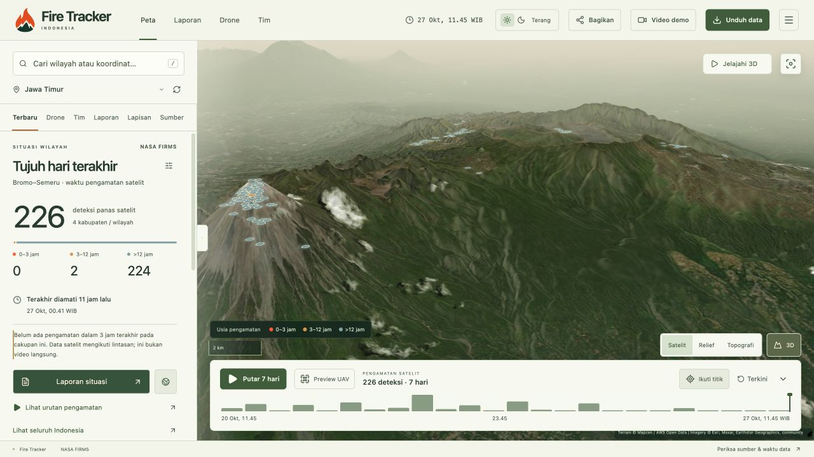
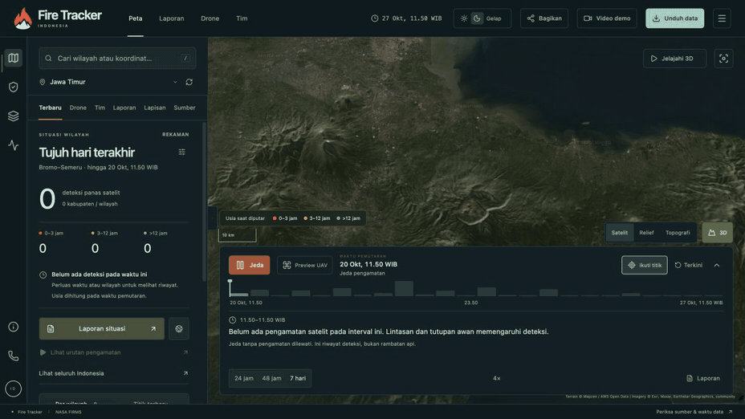
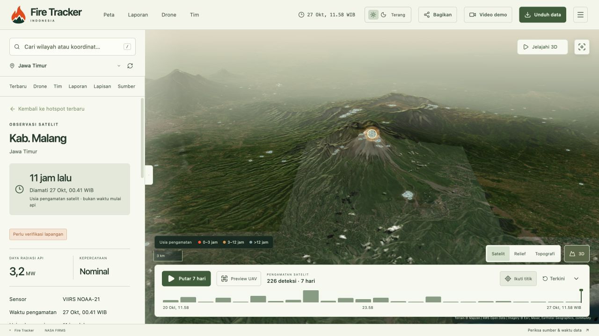
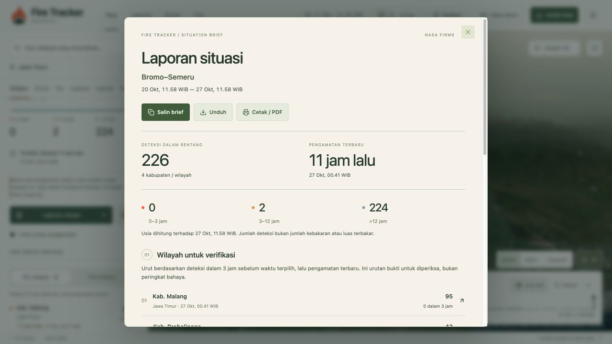
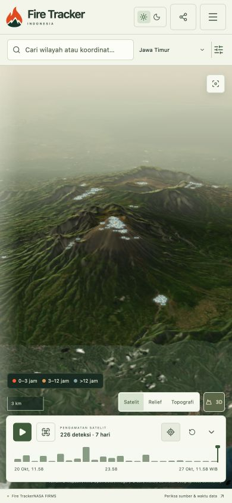
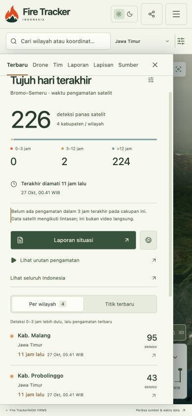
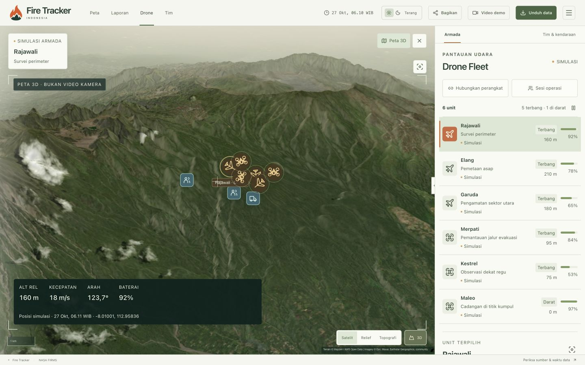

<p align="center">
  <picture>
    <source media="(prefers-reduced-motion: reduce) and (prefers-color-scheme: dark)" srcset="assets/readme/logo-dark.svg">
    <source media="(prefers-reduced-motion: reduce)" srcset="assets/readme/logo-light.svg">
    <source media="(prefers-color-scheme: dark)" srcset="assets/readme/logo-dark.gif">
    
  </picture>
</p>
<h1 align="center">Fire Tracker</h1>
<p align="center">see recent satellite hotspots across Indonesia</p>
<p align="center">
  <a href="https://ghanyr.github.io/fire-tracker/">open the map</a> ·
  <a href="#run-the-map-locally">run locally</a>
</p>

<a href="https://ghanyr.github.io/fire-tracker/#scene=bromo&amp;hours=168">
  <picture>
    <source media="(prefers-color-scheme: dark)" srcset="assets/readme/map-dark.jpg">
    
  </picture>
</a>

NASA FIRMS observations near Bromo–Semeru, captured on 27 October 2026. The terrain is a basemap, not live fire imagery. A satellite hotspot needs ground verification.

## follow the observations

Choose 24 hours, 48 hours, or seven days. Press play to move through satellite acquisition times; the camera follows newly revealed observations. Pause anywhere, inspect the source, and export the filtered data.

<picture>
  <source media="(prefers-reduced-motion: reduce)" srcset="assets/readme/history-still.jpg">
  
</picture>

A shortened recording of the actual app. This is observation history, not a simulation of fire spread. [Replay recording](assets/readme/history.gif) · [Open the same area →](https://ghanyr.github.io/fire-tracker/#scene=bromo&hours=168)

## open a point, check the evidence

Each detection includes its acquisition time, sensor, confidence, coordinates and source link. FRP is shown when available. Copy a brief, download CSV or GeoJSON, or open the coordinate in another map.



## take the context with you

Situation reports keep the selected area, observation window, source timestamps and limitations together. Export a brief for a handoff or print it for offline use.



The map and dated observation list also work on a phone.

<p align="center">
  
  
</p>

## nearby alerts

Choose an area and radius, then enable browser notifications from the bell. New satellite observations can reach the registered browser after the tab is closed; existing points do not trigger an initial alert. A saved area stays fixed. iPhone/iPad require the Home Screen app.

Collection runs every three hours; alert checks run about every fifteen minutes, subject to source, scheduler and device delays. A hotspot still needs ground verification. [Setup, privacy and browser requirements](docs/NEARBY_ALERTS.md).

<details>
<summary>Drone and team tools</summary>

The fleet view shows aircraft, missions, GPS age, battery and flight paths. Ground teams can share positions in a private operation session. EO/IR viewing requires a compatible camera stream.

<a href="https://ghanyr.github.io/fire-tracker/#fleet=1&amp;demo=1">
  <picture>
    <source media="(prefers-color-scheme: dark)" srcset="assets/readme/fleet-dark.jpg">
    
  </picture>
</a>

**The pictured aircraft and teams are simulated.** The 3D view is not camera footage. Real telemetry uses the MAVLink bridge, a compatible DJI gateway, or the JSON SDK. Protocol tests pass; physical aircraft and cameras still need field testing.

Team GPS sharing is opt-in and requires the page to remain in the foreground.

[Try the fleet demo](https://ghanyr.github.io/fire-tracker/#fleet=1&demo=1) · [Device guide](docs/UAV.md) · [JavaScript SDK](sdk/README.md) · [Private operations API](docs/OPERATIONS.md) · [Host the API](server/README.md)

</details>

## run the map locally

Requires **Node 22.13+**. This starts the map frontend; the data pipeline, telemetry bridge and private API are separate services.

```sh
git clone https://github.com/GhanyR/fire-tracker.git
cd fire-tracker
npm ci --prefix tracker
curl --fail --location \
  https://ghanyr.github.io/fire-tracker/data/observations.json \
  --output tracker/public/data/observations.json
npm run dev --prefix tracker
```

Open **http://127.0.0.1:5173**. The download is the published satellite snapshot, with its original source timestamps.

[Developer setup and tests](CONTRIBUTING.md) · [Full reference](docs/REFERENCE.md) · [Data formats](docs/DATA.md) · [GIS feeds](docs/INTEGRASI.md)

## what is in this repo

| Path | What it does |
|---|---|
| [`tracker/`](tracker/) | React + MapLibre dashboard |
| [`pipeline/`](pipeline/) | Satellite and public-data collection; scheduled updates |
| [`bridge/`](bridge/) | Read-only MAVLink / HTTP / WebSocket telemetry bridge |
| [`sdk/`](sdk/) | JavaScript clients and gateway examples |
| [`server/`](server/) | Optional private operations API and database migrations |
| [`web/`](web/) | Legacy field tools and offline support |

## help make it useful

A good first contribution can be a wrong place name with a reproducible example, a keyboard-navigation fix, clearer Indonesian copy, or a sanitized device-compatibility report. Real field feedback is especially welcome.

[Report a bug](https://github.com/GhanyR/fire-tracker/issues/new?template=bug-report.yml) · [Report a device test](https://github.com/GhanyR/fire-tracker/issues/new?template=device-test.yml) · [Contributing guide](CONTRIBUTING.md)

Please keep session keys, private team locations and identifiable flight logs out of public issues. The bridge reads telemetry; it does not send flight commands.

If this is useful to you, a star is appreciated.

## data and scope

Satellite detections are not confirmed incidents, ignition times, burned area or suppression status. Source outages and satellite passes affect availability. The app keeps timestamps visible and retains the last dated snapshot when an update fails.

Data sources include NASA FIRMS, BMKG, SiPongi, BPBD Kotawaringin Barat and PetaBencana. Terrain and imagery attribution stays on the map. Source data and imagery retain their own terms; see the [reference](docs/REFERENCE.md#sumber-data--lisensi).

[MIT](LICENSE) · maintained by [Ghany Rasyid](https://github.com/GhanyR) · [media and capture notes](assets/readme/README.md)
